# MySQL_Chapter7
## Table Of Contents
- [Summary](#summary)
- [Contributer](#contributer)
- [New Concepts Used](#new-concepts-used)
- [Browser Output Examples](#browser-output-examples)
 - [Exercise 1](#exercise-1)
 - [Exercise 2](#exercise-2)
 - [Exercise 3](#exercise-3)
 - [Exercise 4](#exercise-4)
 - [Exercise 5](#exercise-5)
 - [Exercise 6](#exercise-6)
 - [Exercise 7](#exercise-7)

## Summary
This a list of 7 exercises dealing with subqueries and joins.

## Contributer
[@fafal80](https://github.com/fafal80) Faith Coufal

## New Concepts Used
 - Subqueries
 - ALL keyword
 - EXISTS operator

## Browser Output Examples

### Exercise 1
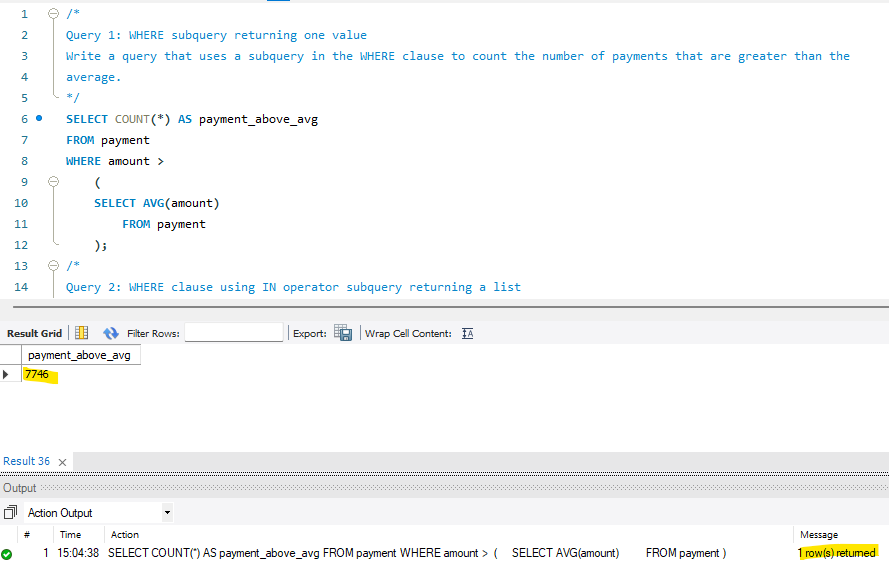

### Exercise 2

#### Exercise 2.A
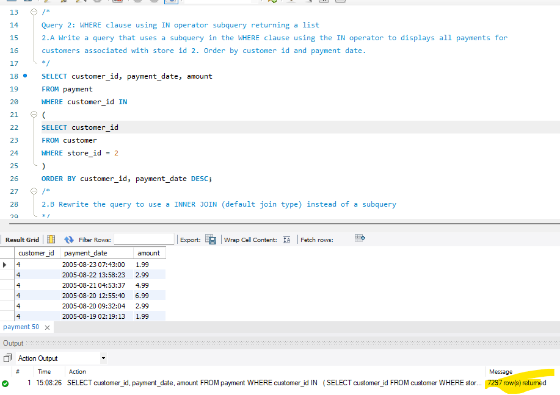

#### Exercise 2.B
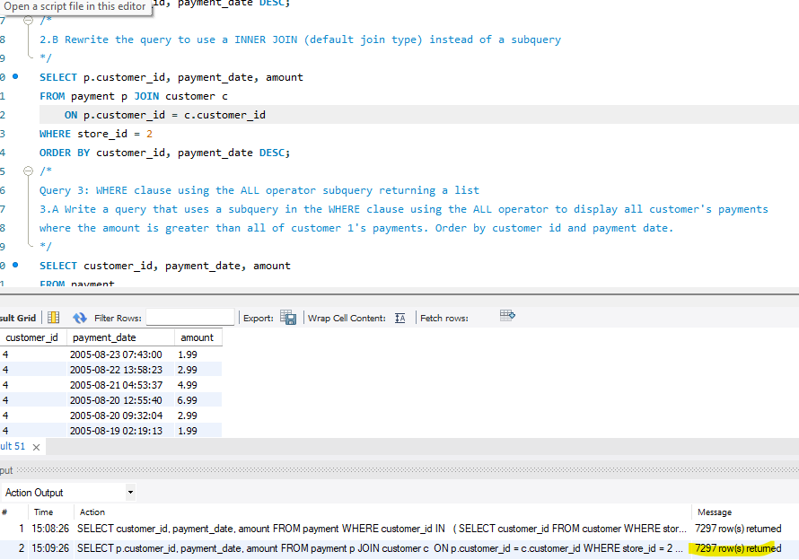

### Exercise 3

#### Exercise 3.A
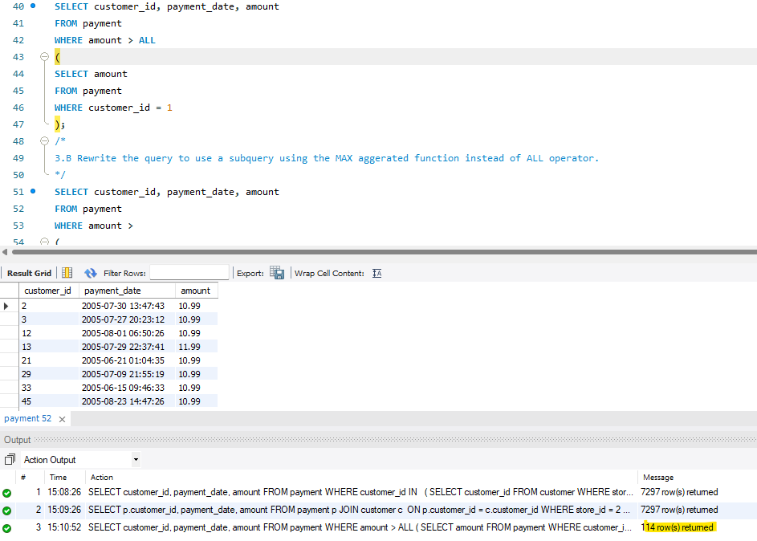

#### Exercise 3.B
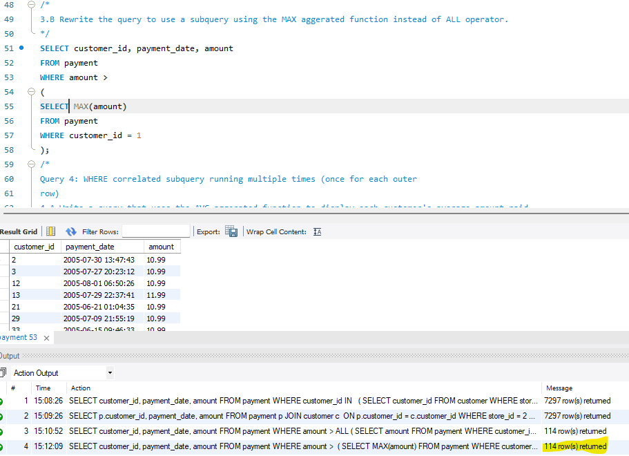

### Exercise 4

#### Exercise 4.A
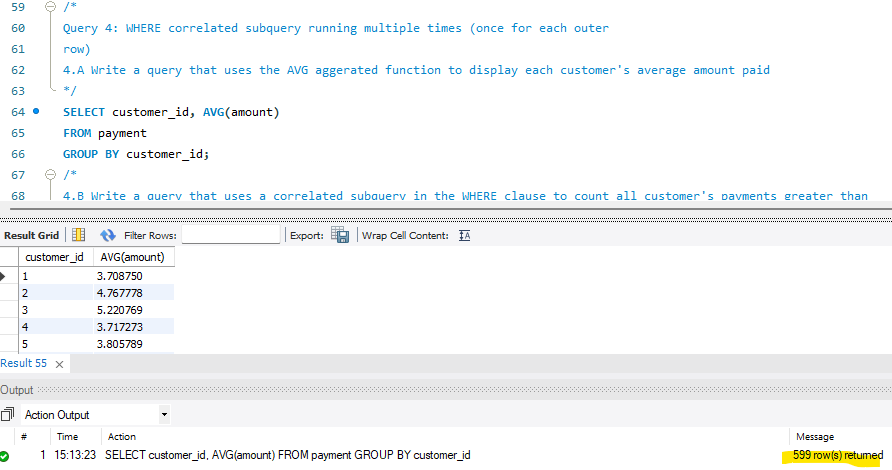

#### Exercise 4.B
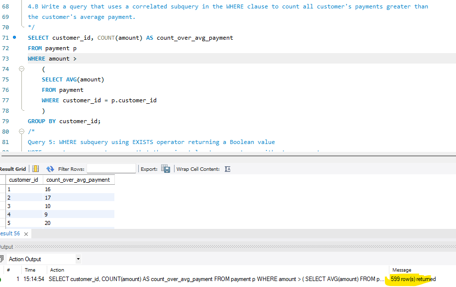

### Exercise 5

#### Exercise 5.A
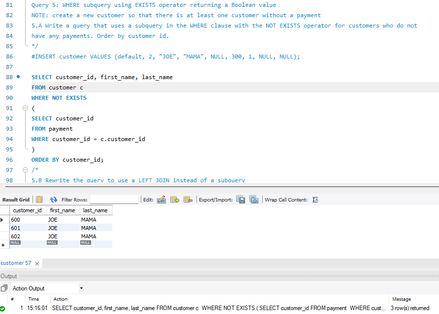

#### Exercise 5.B
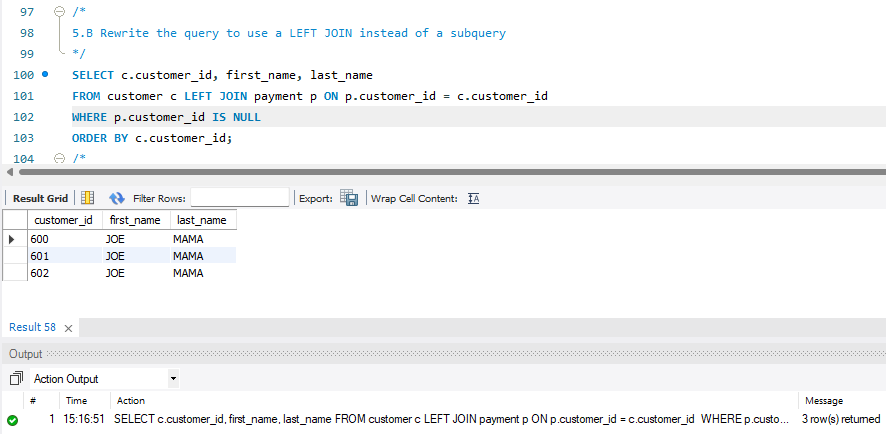

### Exercise 6

#### Exercise 6.A
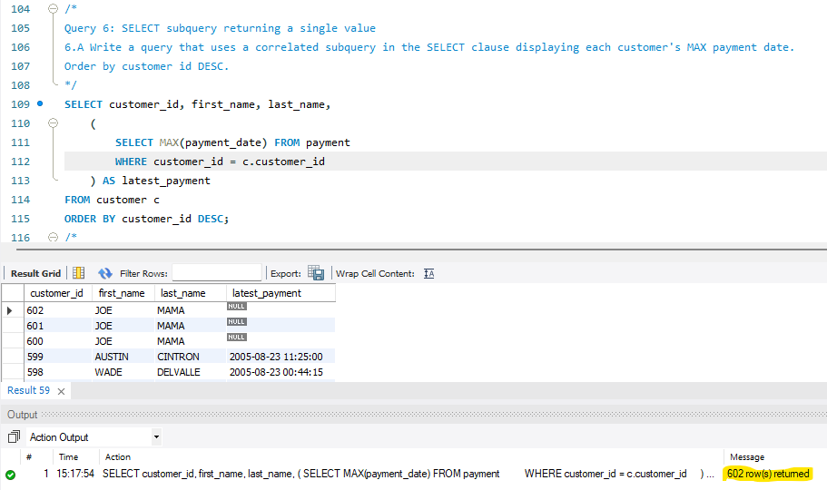

#### Exercise 6.B
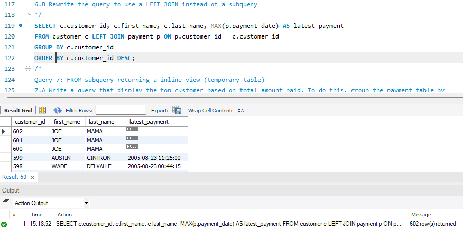

### Exercise 7

#### Exercise 7.A
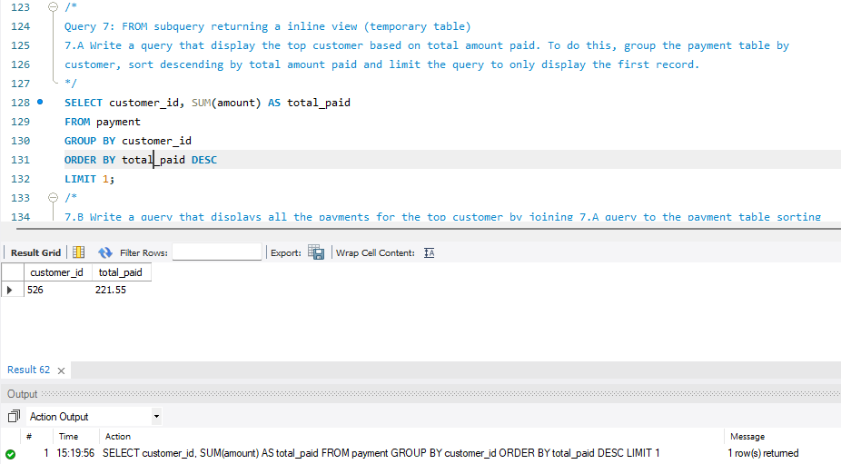

#### Exercise 7.B
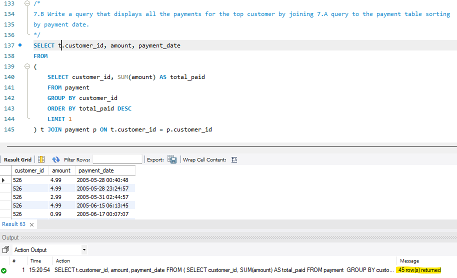
